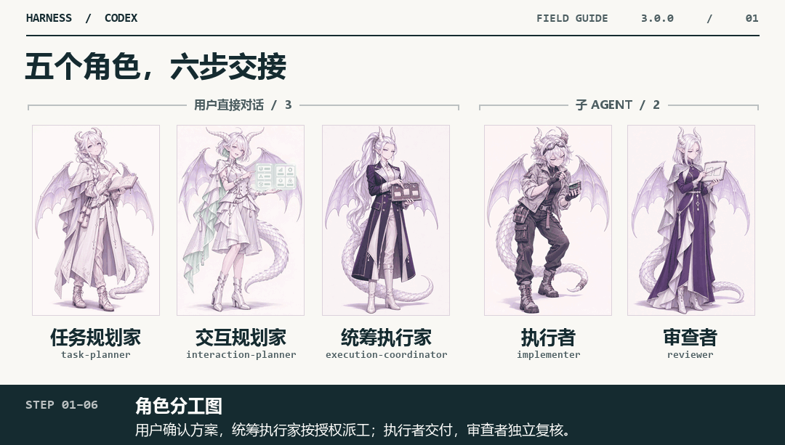
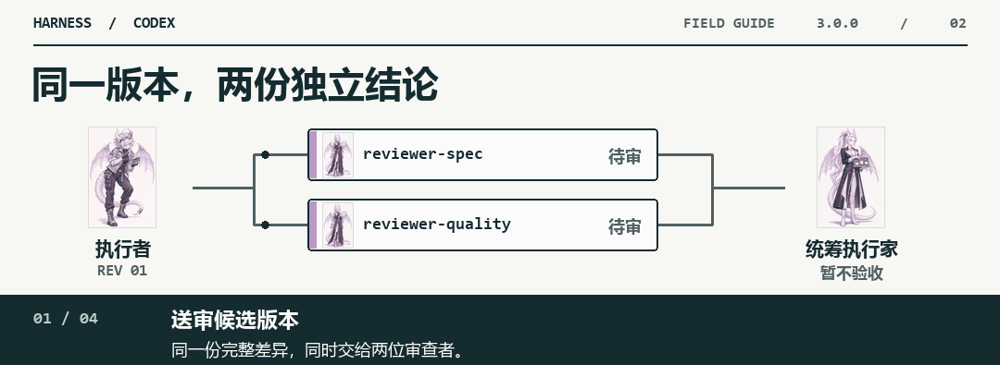

# Harness-AI-Lite · Codex 3.0.1

[English](https://github.com/xuzh0312/Harness-AI-Lite/blob/main/README.md) · **简体中文** · [DeepSeek Harness 中文](https://github.com/xuzh0312/Harness-AI-Lite/blob/main/README.dsh.zh-CN.md) · [DeepSeek Harness English](https://github.com/xuzh0312/Harness-AI-Lite/blob/main/README.dsh.en.md)

**版本备注：Harness框架完整重构。** Harness-AI-Lite 是一套用 Markdown 文件组织软件开发的 Codex 模板。它把一个功能从需求访谈带到可验证的交付：用户和三位对话角色逐步定方案，执行者在授权范围内动手，审查者从两个独立视角核对同一版本。换一个会话，接手人仍能查到：**已经决定了什么、谁还能写、下一步可以做什么。**



[查看静态角色立绘与分工图](docs/assets/codex-v3/roles-zh-CN.png) · [快速开始](#快速开始) · [六步工作流](#六步工作流) · [实例演练](#实例演练) · [执行与双审](#执行与双审) · [版本记录](#版本记录)

## 获取模板

| 想使用什么 | 简体中文 | English |
| --- | --- | --- |
| **Codex 3.0.1 模板 ZIP** | [下载中文 3.0.1 ZIP][zip-zh-301] | [下载英文 3.0.1 ZIP][zip-en-301] |
| **Codex 3.0.1 模板目录** | [打开 zh-CN-codex](zh-CN-codex/) | [打开 en-codex](https://github.com/xuzh0312/Harness-AI-Lite/tree/main/en-codex) |
| **上一版 2.1.0 独立 ZIP** | [下载中文包][zip-zh-21] | [下载英文包][zip-en-21] |

解压对应语言的 3.0.1 ZIP，先读包根的 `README.md`，再进入语言目录，只复制其中的 `harness/`、`project/` 和 `test/`。包根 `docs/assets/` 是本指南的离线图文素材，不是第四个工作区域。也可以直接从仓库复制同一套模板。历史包保留当时的协议；仓库根目录的维护规则不用复制。DeepSeek Harness 是另一种运行器，请使用其独立指南。

## 3.0.0 改了什么

| 在 2.x 中 | 在 3.0.0 中 |
| --- | --- |
| 主 agent 在“直接修改”和“先规划”之间分流。 | 首版和新增功能按同一套六步交接。已有产品只规划这次增量；按既有契约修缺陷另走维护路径。 |
| `UIdesign` 是子角色。 | 用户直接与**交互规划家**定 UI/UX；只有获准制作预览时，才委托执行者写入 `test`。设计选择不等于授权写产品代码。 |
| 从 `.agents/skills/` 和主 agent 手册找入口。 | `harness/agents/` 放角色，`harness/skills/` 放技能；[运行入口](zh-CN-codex/harness/AGENTS.md)按本步指路，[执行手册](zh-CN-codex/harness/docs/runbooks/execution.md)专管第 6 步。 |
| 主要从活动计划了解任务进度。 | 在 Plan 形成前，访谈、参考、选型和交互方案已可分别交接。热路径指向当前文件，冷路径保存历史位置；批准与授权仍以原文为准。 |

这是一套**工作协议，不是后台调度服务**。打开仓库不会自动创建五个 agent，多个窗口也不会自动共享聊天、权限或进度。角色由用户和当前会话显式选择，文件负责交接。

## 快速开始

1. **选一套语言，部署一个副本。** 三个目录可分盘。已有项目不必迁移：让路径表里的 `project/code` 指向现有代码根，保留原仓库、既有测试和跟踪状态。确有工具要求固定目录，再与用户确认例外。
2. **登记项目和位置。** 在副本的 [项目简介](zh-CN-codex/harness/README.md)填写用途、用户、范围和模板来源；在[热路径](zh-CN-codex/harness/docs/paths.md)填写 `harness`、`project`、`project/code`、`test` 的实际绝对路径。`project/code` 只是代码根的映射，不是第四个区域。
3. **核对实际能力。** 读取[架构与边界](zh-CN-codex/harness/ARCHITECTURE.md)及目标目录规则，分别确认可读、可写和允许运行的检查。技术栈未定可留待第 2 步讨论，不要预填猜测。需要首次派出子 agent 时再核对[模型约定](zh-CN-codex/harness/agents/MODELS.md)。
4. **从当前需要的那一步开始。** 新项目可使用下面的提示；接手已有功能时给出功能编号、当前材料及本次委托。只读就是只读，不占正式编号、不创建记录；“只复核”不会启动实施。

```text
请先读 <Harness 实际路径>/AGENTS.md 和 docs/paths.md。
本次目标：给现有列表增加“导出当前筛选结果”。
这次只做第 1 步。请作为任务规划家和我访谈，再一起决定是否需要开源调研。
允许在项目副本登记本功能并写访谈和参考记录；不改产品代码，不运行测试。
结束时告诉我：已确认什么、还缺什么，以及下次应打开哪份文件。
```

可直接改用[六种接手提示](zh-CN-codex/harness/docs/runbooks/start-task-template.md)。从旧版升级时，先备份已部署的 Harness，按原协议版本、来源提交或包校验值比对，**只合并协议差异**。不要用空模板覆盖已填写的项目介绍、架构、路径、计划、定制规则或历史证据。

## 五个角色

| 角色 | 谁和它交互 | 负责什么，在哪里停下 |
| --- | --- | --- |
| [任务规划家](zh-CN-codex/harness/agents/task-planner/AGENT.md) `task-planner` | 用户直接对话 | 第 1、2、4、5 步：访谈、开源参考、功能与选型、整体方案和实施 Plan。可由另一会话只读复核同一版；不能代用户批准，也不提前派人实现。 |
| [交互规划家](zh-CN-codex/harness/agents/interaction-planner/AGENT.md) `interaction-planner` | 用户直接对话 | 第 3 步：沿真实任务确定入口、关键状态、反馈与恢复。受托后派执行者在指定的 `test` 位置做预览，收集用户反馈；涉及新功能或换栈则交回任务规划家。 |
| [统筹执行家](zh-CN-codex/harness/agents/execution-coordinator/AGENT.md) `execution-coordinator` | 用户直接对话 | 第 6 步：核对批准版本、授权项和在途写入者，派工、处理返工、核实证据、逐项及整体验收。不能放宽标准，也不能自行裁决有争议的发现。 |
| [执行者](zh-CN-codex/harness/agents/implementer/AGENT.md) `implementer` | 由对话角色派出 | 有两类委托：在 `test` 制作模拟预览，或按统筹执行家的授权项实现并自验。回报完整改动、验证与缺口；不自批、不派审查者、不自行开始下一项。 |
| [审查者](zh-CN-codex/harness/agents/reviewer/AGENT.md) `reviewer` | 由负责送审的对话角色派出 | 默认只读。`reviewer-spec` 对照要求找遗漏，`reviewer-quality` 从差异检查错误路径与回归。它们是**同一角色的两个独立实例**，各自报告，不改实现或审批记录。 |

前三个角色可以在同一会话切换，也可由不同会话接手；角色相同不代表委托自动延续。项目模型约定只管后两类子实例：首次派工前若没有适用答复，先问用户对模型和推理深度的限制；之后在适用范围内沿用。若不能按约定取得独立实例，应报告阻塞，而不是把作者自审写成双审。

## 六步工作流

下表路径均相对于部署后的 `harness/`。`<ID>` 形如 `PLAN-0001`：首份正式材料获准写入时即可占号，**第 5 步才创建实施 Plan**。各阶段复用同一编号，不按会话另开一套。

| 步骤与负责人 | 当场解决的问题 | 交给下一步的材料 |
| --- | --- | --- |
| **1 · 需求与参考** · 任务规划家 | 谁在什么场景遇到什么问题？一次追问一个影响取舍的问题，边谈边记。与用户决定是否调研；若调研，固定来源版本、许可证依据和拟借鉴部分。 | `docs/specs/<ID>/interview.md` 与 `references.md`（同目录）。跳过调研也写明理由，不把“没查”写成“没有候选”。 |
| **2 · 功能与技术栈** · 任务规划家 | 用前两份记录和现有实现确认入口、输入输出、异常、成功条件；比较沿用或更换技术栈的代价。 | `docs/specs/<ID>/features-stack.md`。报告写清用户确认和未决项；候选栈已确认，不代表已安装或已生效。 |
| **3 · UI/UX** · 交互规划家 | 读取前三份材料，沿一次任务讨论反馈、失败和恢复。有必要再做预览；没有界面影响则请用户确认范围和理由。 | `docs/specs/<ID>/uiux.md`。登记选定方向、稿件版本、反馈和待实测场景；不为无界面功能造稿。 |
| **4 · 项目方案** · 任务规划家 | 把功能、栈、交互或不适用结论收成一份执行用规格。逐项核对模块、数据、接口、兼容与验收能否互相支持。 | `docs/specs/<ID>.md`。用稳定的 `AC-01` 等编号描述可观察结果；关键冲突未解，不拆实施清单。 |
| **5 · 实施 Plan** · 任务规划家 | 把 AC 映射到 `PLAN-0001.01` 等编号项，列明依赖、可写范围、逐项检查和整体验收。向用户一起展示方案和 Plan 的具体版本。 | `docs/plans/active/<ID>.md`。在一处记录用户批准的版本组合、依据，以及另行授权实施的项。只要求规划，就在此停下。 |
| **6 · 执行与验收** · 统筹执行家 | 核对批准组合及实施授权，一次派一个获准实现项。实现、自验、独立双审和验收后再派下一项；最后检查跨项集成。 | 沿用同一份 Plan，记录受审版本、证据位置、返工与下一步；未授权的待办项仍留在 `active/`。 |

每份阶段材料开头都有**交接卡**：本步和版本、输入版本、用户已确认的内容及依据、未决项、当前写入者和下一步。用户改了上游决定时，标出受影响的下游项并暂停相关工作，不重做无关部分，也不借旧批准执行新范围。详见[阶段产物约定](zh-CN-codex/harness/docs/specs/README.md)、[方案模板](zh-CN-codex/harness/docs/specs/TEMPLATE.md)和 [Plan 模板](zh-CN-codex/harness/docs/plans/TEMPLATE.md)。

## 实例演练

**示例：给已有列表增加 CSV 导出。** 以下编号、版本和发现都只是教学示例，不是模板已完成的项目或测试结果。

| 一句容易误解的话 | 在框架里如何落地 |
| --- | --- |
| “给我加个导出。” | 任务规划家问：上次筛完列表后，你要拿走哪些行？用户要的是**当前筛选的所有结果**，不是当前页，也不是整库。第 2 步明确列顺序、空结果策略，沿用已有栈。 |
| “我想先看看。” | 交互规划家与用户约定导出入口、空列表提示、写入失败后重试。获准才在 `test` 做预览；看稿能确认文案与方向，不能证明真的写出了正确文件。 |
| “方案没问题，先做导出逻辑。” | 假设批准的是方案 v2 + Plan v1，且只授权 `.01` 导出逻辑。`AC-01` 可用“结果跨两页、另有一条被筛除”验证：文件包含两页匹配行，排除那一条，列顺序正确。`.02` 界面接线仍待授权。 |
| “测试过了，为什么还没验收？” | 在下面的双审示例中，规格实例建议通过；质量实例找到写入失败后的资源清理缺陷。执行者修复后，两个实例都要看修订版，统筹执行家还要核对失败后重试的证据。 |
| “那就把安装包也做了吧。” | 这是额外的打包授权；先明确对应版本与范围。构建成功不是制品验收，生成安装包也不等于用户同意发布。 |

## 执行与双审



[查看四格静态分镜](docs/assets/codex-v3/review-zh-CN.png) · [执行协议](zh-CN-codex/harness/skills/subagent-driven-execution/SKILL.md) · [审查结论与争议处理](zh-CN-codex/harness/agents/reviewer/AGENT.md)

1. **冻结送审版本。** 每个实现项由新的执行者处理；统筹执行家把同一份需求、基线至当前版本的完整差异、执行报告和原始证据交给两个只读实例。两者不读对方结论。并发不足可顺序审，但必须保留两个独立上下文并如实记录。
2. **分别回答两个问题。** 规格审查问“是不是用户批准的行为，有没有漏项或额外范围？”质量审查问“在哪里会失败，会不会破坏原有行为，检查是否真能发现错误？”分别保留“建议通过／需返工／证据不足”和覆盖版本。
3. **修复后不能拼报告。** 优先交原执行者与原审查组；对受影响行为重验，两者都确认同一最终版本。意见仍冲突时，先回传证据复核，再交用户裁决具体发现。裁决不能替代缺少的报告、未运行的必需检查或未满足的 AC。
4. **逐项通过不等于全功能通过。** 当前批准范围内的实现项全部通过后，新建两位审查者检查完整规格覆盖、跨项接口、回归和最终证据。未获实施授权的项保留待办；整份 Plan 满足最终验收才归档。验收不会自动提交、推送、合并、打包或发布。

**独立修复不是新增功能的捷径。** 例如，按已有导出契约修复文件句柄泄漏，可用 `TASK-0001` 记录原症状、复现条件、基线、两份独立报告和复验；无需补造功能方案。若用户改为要求另一种导出行为，则是功能变更，回到相应规划步骤。普通问答不建 TASK。参见[编号与归档](zh-CN-codex/harness/docs/plans/README.md)。

## 三个工作区域

| 区域 | 应该放什么 | 容易放错的东西 |
| --- | --- | --- |
| [`harness/`](zh-CN-codex/harness/) | 项目介绍、规则、角色、技能、阶段材料、Plan、决策、错误知识库。 | Plan 记证据的位置和覆盖版本，不塞原始日志、真实数据或项目原型。 |
| [`project/code/`](zh-CN-codex/project/code/) | 交付软件本体的源码、运行资源、必要依赖与构建配置、属于软件的启动入口。 | 新增测试、复现脚本、打包辅助工具默认去 `test`；保留已有项目中原本的测试位置。 |
| [`test/`](zh-CN-codex/test/README.md) | 测试与工具源码、模拟稿、数据、原始日志、截图、普通构建与检查结果。 | 可共享源码用 `src/`；获准共享的定稿用 `approved-designs/`。敏感或大文件默认忽略；校验值能辨认版本，不能代替可恢复的备份。 |
| [`project/installpark/`](zh-CN-codex/project/installpark/)（属于 `project`） | 只存明确获准生成的最终 ZIP。 | 不存普通构建、中间文件或解包目录。在独立的 `test` 位置解包，从包内入口核对启动或安装，不能借源码树通过。 |

部署后的 `harness`、实际代码根和 `test` 分别版本控制；`installpark` 不在这三个仓库里。用同一 PLAN/TASK 编号关联各自版本。初始化或迁移仓库需另有授权；没有提交就记录基线与工作树差异，不编造提交号。

## 跨会话恢复

| 遇到的情况 | 接手动作 |
| --- | --- |
| 新会话只知道功能编号 | 从[热路径](zh-CN-codex/harness/docs/paths.md)打开该功能当前入口，核对交接卡、实际版本、批准、授权和在途写入者。不要扫整个冷档或凭旧聊天判断完成。 |
| 两个会话想写同一个文件 | 同一文件、Plan 或共享编号同时只有一位写入者。热表、冷表、错误库、模型约定用同副本的原子 `.lock`；锁不按超时强拆。要先确认旧写入者和相关命令已停或已隔离。 |
| 设计稿将作为验收依据 | 在批准、首次派工及恢复实施前，取回固定版本和必要资源并核对校验值。稿件无法恢复则暂停依赖项，或由用户确认能独立验收的文字依据。 |
| 任务完成、取消，或旧任务要重开 | 完成或确认停写后的取消记录转入 `completed/`。仍被活跃任务引用的证据留热；无活跃依赖才把**索引**归入[冷路径](zh-CN-codex/harness/docs/paths-cold.md)，不是移动或删除原件。重开时核对现状，不自动恢复已撤回授权。 |
| 同类缺陷再次出现 | 审查者用 [bug-detect](zh-CN-codex/harness/skills/bug-detect/SKILL.md)按触发机制与根因查旧项，提议复用或重开 BUG 编号；送审的对话角色串行写[项目错误库](zh-CN-codex/harness/docs/bugs.md)。建议修法和已验证方案分开。 |

## 技能与参考

技能由角色按路径显式读取，不要求运行器自动发现。可从[技能索引](zh-CN-codex/harness/skills/README.md)或[角色与派工简报](zh-CN-codex/harness/agents/TASK_TEMPLATE.md)进入。

| 技能 | 什么时候用 |
| --- | --- |
| [feature-plan](zh-CN-codex/harness/skills/feature-plan/SKILL.md) | 第 1、2、4、5 步，用真实经历访谈、记录参考取舍、核对可行性，并把规格映射到编号清单。 |
| [tech-stack-plan](zh-CN-codex/harness/skills/tech-stack-plan/SKILL.md) | 第 2 步比较候选栈。首次启用或换栈时，由统筹执行家在授权下送审完整架构差异；同一候选通过双审并原样落盘核对后，依赖新栈的实现才能开始。 |
| [UIUX-design](zh-CN-codex/harness/skills/UIUX-design/SKILL.md) | 第 3 步从任务路径走到关键状态和失败恢复。需要选择动效时，与用户比较强、普通或弱动效；用[离线 UI 技法图鉴](zh-CN-codex/harness/skills/UIUX-design/assets/index.md)比较布局、动效与材质，不把样板当产品实测。 |
| [subagent-driven-execution](zh-CN-codex/harness/skills/subagent-driven-execution/SKILL.md) | 第 6 步从获准项派工，到逐项双审、返工、整体验收与交付。 |
| [bug-detect](zh-CN-codex/harness/skills/bug-detect/SKILL.md) | 审查者确认缺陷或复验时，查询同根因记录，区分新发现、复发和仍待定位的问题。 |

访谈方式参考 GrillMe，逐项执行和独立审查参考 Superpowers；两者都是可选工具。规则冲突或接入问题可通过 Issue 反馈，请勿附带真实项目的敏感资料。本项目采用 [MIT 许可证](LICENSE)。

## 版本记录

| Codex 版本 | 日期 | 备注 | 获取 |
| --- | --- | --- | --- |
| **3.0.1** | 2026-11-25 | **修复部分bug** | [中文 ZIP][zip-zh-301] · [English ZIP][zip-en-301] |
| **3.0.0** | 2026-11-24 | **Harness框架完整重构** | [中文 ZIP][zip-zh-30] · [English ZIP][zip-en-30] |
| 2.1.0 | 2026-11-22 | 强化 UIUX-design 技能，提供可离线使用的 UI 技法图鉴。 | [中文 ZIP][zip-zh-21] · [English ZIP][zip-en-21] |
| 2.0.0 | 2026-11-21 | 调整子 agent 分工与技能，引入 UIdesign 角色和 UI 设计流程。 | [中文 ZIP][zip-zh-20] · [English ZIP][zip-en-20] |
| 1.0.0 | 2026-11-17 | 初版：三个工作区域、需求确认、分工实现、双重审查与证据验收。 | [中文 ZIP][zip-zh-10] · [English ZIP][zip-en-10] |

[zip-zh-30]: https://raw.githubusercontent.com/xuzh0312/Harness-AI-Lite/main/downloads/Harness-AI-Lite-codex-zh-CN-3.0.0.zip
[zip-zh-301]: https://raw.githubusercontent.com/xuzh0312/Harness-AI-Lite/main/downloads/Harness-AI-Lite-codex-zh-CN-3.0.1.zip
[zip-en-30]: https://raw.githubusercontent.com/xuzh0312/Harness-AI-Lite/main/downloads/Harness-AI-Lite-codex-en-3.0.0.zip
[zip-en-301]: https://raw.githubusercontent.com/xuzh0312/Harness-AI-Lite/main/downloads/Harness-AI-Lite-codex-en-3.0.1.zip
[zip-zh-21]: https://raw.githubusercontent.com/xuzh0312/Harness-AI-Lite/main/downloads/Harness-AI-Lite-codex-zh-CN-2.1.0.zip
[zip-en-21]: https://raw.githubusercontent.com/xuzh0312/Harness-AI-Lite/main/downloads/Harness-AI-Lite-codex-en-2.1.0.zip
[zip-zh-20]: https://raw.githubusercontent.com/xuzh0312/Harness-AI-Lite/main/downloads/Harness-AI-Lite-codex-zh-CN-2.0.0.zip
[zip-en-20]: https://raw.githubusercontent.com/xuzh0312/Harness-AI-Lite/main/downloads/Harness-AI-Lite-codex-en-2.0.0.zip
[zip-zh-10]: https://raw.githubusercontent.com/xuzh0312/Harness-AI-Lite/main/downloads/Harness-AI-Lite-codex-zh-CN-1.0.0.zip
[zip-en-10]: https://raw.githubusercontent.com/xuzh0312/Harness-AI-Lite/main/downloads/Harness-AI-Lite-codex-en-1.0.0.zip
