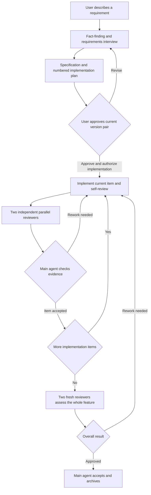

# Harness-AI-Lite · DeepSeek Harness

**Keep harness management, product implementation, and testing in separate locations for convenient AI development and a clean project.**

[Codex English](README.md) · [Codex 中文](README.codex.zh-CN.md) · [DeepSeek Harness 中文](README.dsh.zh-CN.md) · [Quick start](#quick-start)

Harness-AI-Lite is a lightweight harness engineering template inspired by GrillMe and Superpowers. Copy the directories, fill in your project introduction, technology stack, and actual paths, then let the main agent coordinate analysis, implementation, review, rework, and delivery through a consistent protocol.

It is intended for individual developers and small teams that want to reuse their development conventions across projects, including workspaces where management documents, product code, and testing materials live on different disks. It is independent of any particular language, framework, or application type. This guide covers the earlier DeepSeek Harness edition, which uses the four-role workflow and DeepSeek model routing. End-to-end operation of this edition has yet to be verified.

## The key idea: three independently located areas

Harness-AI-Lite centers on **separating harness, project, and test**. Place them in different directories or on different disks, without a shared parent. Connect them by recording their actual paths in `harness/docs/paths.md`.

- **harness management area**: Rules, requirements, plans, decisions, and concise logs stay together for easy inspection and task recovery.
- **project product area**: Product implementation and explicitly authorized final installers keep the product directory focused.
- **test testing area**: Tests, helper tools, data, raw logs, caches, and intermediate artifacts have their own home.

This makes directory placement convenient for users' storage, backup, and working preferences while keeping management documents, product files, and verification materials organized. Language directories in this repository are distribution containers; deployed projects do not need to retain a shared directory structure.

## Downloads

| Edition | ZIP download |
| --- | --- |
| DeepSeek Harness English | [Harness-AI-Lite-en-deepseekharness.zip](https://github.com/xuzh0312/Harness-AI-Lite/raw/refs/heads/main/downloads/Harness-AI-Lite-en-deepseekharness.zip) |
| DeepSeek Harness Chinese | [Harness-AI-Lite-zh-CN-deepseekharness.zip](https://github.com/xuzh0312/Harness-AI-Lite/raw/refs/heads/main/downloads/Harness-AI-Lite-zh-CN-deepseekharness.zip) |

Each archive includes its runtime and language edition, usage guide, and MIT license. Extract it, copy the included `harness`, `project`, and `test` directories to your chosen locations, then fill in the project introduction, stack, and paths to configure your project. Archives are published in the repository's `downloads/` directory.

## Why this project exists

Writing code is only one part of agent-assisted development. Requirements interpretation, task assignment, independent checks, recovery after failure, and the location of verification evidence also need explicit agreements.

AI-assisted development can also leave all kinds of files in the working directory, making projects difficult for beginners to navigate. This template separates those materials into distinct areas.

This project keeps those agreements in project files. Users can review the plan, executors receive clear boundaries, and new sessions can resume from existing records. It provides an inspectable collaboration protocol, rather than a background scheduling service or a guarantee that every model will follow every rule.

## Core design

| Design | How it works |
| --- | --- |
| Three separate work areas | harness stores management documents, project stores product implementation and explicitly authorized installers, and test stores testing and all non-product development materials |
| Approval before implementation | The main agent clarifies requirements in rounds, maintains a specification and numbered plan, and presents both for approval of their current version pair |
| Four subagent role types | architect analyzes, implementer implements, infra handles infrastructure, and reviewer reviews independently |
| Two parallel review instances | reviewer-spec checks specification compliance; reviewer-quality checks implementation quality at per-item and final whole-feature review |
| Evidence-based acceptance | Record actual checks, covered versions, and limitations; failed or unperformed mandatory checks cannot count as passing |
| Resumable task records | Each feature retains one active plan containing approval, assignments, delivery summaries, rework, and next steps |
| Reusable defect knowledge | Confirmed defects are deduplicated by root cause, with solutions, applicability, and verification evidence |
| Central model configuration | Subagent models and reasoning effort come only from the selected copy's MODELS.md |

## Workflow



The main agent owns conversation, dispatch, shared records, and final acceptance. Subagents do not spawn nested agents or directly edit shared progress and defect records.

Both reviewers must return separate conclusions for the same final version. If concurrency is limited, run two independent instances sequentially instead of combining them. A missing report, required rework, or insufficient evidence prevents acceptance.

## Repository structure

```text
.
├── README.md
├── README.codex.zh-CN.md
├── README.dsh.en.md
├── README.dsh.zh-CN.md
├── zh-CN-codex/
├── en-codex/
├── zh-CN-deepseekharness/
└── en-deepseekharness/
    # Each edition contains: harness/ + project/ + test/
```

The two DeepSeek Harness language variants share their skills, roles, numbering conventions, and model routing. Use one template as the rule source for each project.

| Area | Contents |
| --- | --- |
| harness | Project introduction, stack, rules, role and skill instructions, specifications, plans, decisions, defect knowledge, and concise log documents |
| project/code | Delivered product implementation, runtime resources, and necessary project metadata, dependency manifests, and build configuration |
| project/installpark | Final installers generated after an explicit packaging request or approval of a packaging plan item |
| test | All non-product code, including tests, verification and packaging helpers, plus data, raw logs, screenshots, caches, intermediate artifacts, and non-installer output |

Product source may be compiled into the application; source files need not ship unchanged in an installer. Tests and tools do not become product implementation merely because they participate in a build. Fixed tool directories conflicting with these boundaries must be reported for an explicit user decision.

## Quick start

### 1. Choose a language

Download and extract the ZIP for your language or open the matching directory in this repository. Choose either `en-deepseekharness/` or `zh-CN-deepseekharness/` and copy its `harness`, `project`, and `test` directories to your project locations.

The directories can live on different disks without a common parent. Give each project its own copy instead of sharing plans or defect records.

### 2. Fill in three files

Replace `@@` in the deployed copy, without writing real project details back into the clean template.

| File | Information to provide |
| --- | --- |
| harness/README.md | Purpose, target users, feature scope, and constraints |
| harness/ARCHITECTURE.md | Stack, target platform, delivery format, and architecture constraints |
| harness/docs/paths.md | Actual absolute paths of harness, project, and test |

Mark unresolved technology choices as pending and resolve them during planning. The main agent maintains specifications, plans, decisions, and defect records from actual tasks; users do not need to fill in every document beforehand.

### 3. Configure the runtime

The runtime needs Markdown reading, access to the three actual directories, independent subagent creation, and explicit model and reasoning-effort selection at creation time.

Check that `harness/agents/MODELS.md` in your selected copy is supported by your runtime. Verify routes with `list_subagent_models` and explicitly pass provider, model, and reasoning_effort. Both reviewers use the reviewer configuration, with actual parameters recorded separately for each instance. The runtime controls the main agent's model.

Roles and skills are explicitly read by the main agent rather than installed as native runtime configuration. Opening directories does not automatically load rules or grant access. Missing capabilities must be reported as blockers rather than treated as completed execution or review.

### 4. Submit your first task

Send this in conversation:

```text
Read <actual absolute harness path>/AGENTS.md
and follow its protocol for this project task:

<Describe the feature or problem in plain language>

Existing plan: <None, or provide its identifier/path>
```

For example, ask for CSV export from an existing list. The agent investigates the implementation and clarifies export scope, format, and boundary behavior. Review the resulting specification, plan versions, and complete numbered checklist before explicitly confirming whether implementation should begin.

Supply the entry and existing plan again in a new session. Planning-only requests do not start implementation automatically. Material changes need revised approval; typos and still-valid approvals do not require repeated confirmation. You can specify your preferred conversation language while using the English rules.

## Bundled skills and roles

| Skill | Purpose |
| --- | --- |
| [feature-plan](en-deepseekharness/harness/.agents/skills/feature-plan/SKILL.md) | Requirements interviews, specifications, automatic plan numbering, user approval, and revisions |
| [subagent-driven-execution](en-deepseekharness/harness/.agents/skills/subagent-driven-execution/SKILL.md) | Item-by-item dispatch of approved plans, two reviewers, rework, resumption, and final acceptance |
| [bug-detect](en-deepseekharness/harness/.agents/skills/bug-detect/SKILL.md) | Searching defect history, deduplication by root cause, and solution verification |

Skills live in `harness/.agents/skills/`. Global installation is unnecessary, and automatic runtime discovery is not guaranteed. Pure Q&A, minor wording changes, and fixes under existing contracts do not require a new feature specification and plan.

| Role | Main responsibility |
| --- | --- |
| architect | Read-only investigation, options, boundaries, dependencies, and acceptance recommendations |
| implementer | Assigned implementation, tests, self-review, and focused validation |
| infra | Environment, dependency tools, builds, CI, and explicitly authorized packaging |
| reviewer | Two independent read-only instances assessing specification compliance and implementation quality |

See the [role protocol](en-deepseekharness/harness/agents/README.md) for responsibilities, access boundaries, and handoff format. Agents are not created merely to include every role when no corresponding work is needed.

## Documentation

| Document | English | 中文 |
| --- | --- | --- |
| Runtime entry | [AGENTS.md](en-deepseekharness/harness/AGENTS.md) | [AGENTS.md](zh-CN-deepseekharness/harness/AGENTS.md) |
| Architecture and file boundaries | [ARCHITECTURE.md](en-deepseekharness/harness/ARCHITECTURE.md) | [ARCHITECTURE.md](zh-CN-deepseekharness/harness/ARCHITECTURE.md) |
| Model configuration | [MODELS.md](en-deepseekharness/harness/agents/MODELS.md) | [MODELS.md](zh-CN-deepseekharness/harness/agents/MODELS.md) |
| Main-agent handbook | [Execution handbook](en-deepseekharness/harness/docs/runbooks/main-agent.md) | [执行手册](zh-CN-deepseekharness/harness/docs/runbooks/main-agent.md) |
| Detailed task starter | [Task starter](en-deepseekharness/harness/docs/runbooks/start-task-template.md) | [启动模板](zh-CN-deepseekharness/harness/docs/runbooks/start-task-template.md) |
| Requirements specification | [Specification template](en-deepseekharness/harness/docs/specs/TEMPLATE.md) | [规格模板](zh-CN-deepseekharness/harness/docs/specs/TEMPLATE.md) |
| Execution plan | [Plan template](en-deepseekharness/harness/docs/plans/TEMPLATE.md) | [计划模板](zh-CN-deepseekharness/harness/docs/plans/TEMPLATE.md) |
| Defect knowledge base | [bugs.md](en-deepseekharness/harness/docs/bugs.md) | [bugs.md](zh-CN-deepseekharness/harness/docs/bugs.md) |
| Skills directory | [Skills](en-deepseekharness/harness/.agents/README.md) | [技能说明](zh-CN-deepseekharness/harness/.agents/README.md) |

A feature's specification and plan share a PLAN identifier, while implementation items and acceptance scenarios have stable identifiers of their own. Active plans live in `docs/plans/active/`; completed or cancelled plans move to `completed/`. Specifications remain in place with updated links. Design decisions and actual technical debt belong in `docs/decisions/` and `docs/tech-debt.md`.

Either reviewer invokes bug-detect when confirming a defect or rechecking a fix. The main agent deduplicates before writing `docs/bugs.md`. This is not an automatic exception collector: raw runtime logs and reproduction code belong in test, matching-root-cause recurrences update the original entry, and resolution requires verification.

## Git and delivery conventions

- The deployed harness and project/code use independent Git repositories; the three areas need no shared root repository.
- Keep test and installers separate. Areas without Git can use pre-change snapshots and content comparisons as review evidence.
- Initialization, commits, pushes, merges, and publication follow actual task authorization; acceptance does not automatically authorize them.
- Normal builds, passing tests, and feature completion do not trigger packaging. Only an explicit request or approved packaging item produces a final installer.
- Local checks do not replace target-environment acceptance. Delivery must state actual validation and remaining limitations.

## Design references and contributions

The interview approach draws on GrillMe, while item-by-item execution and review draw on Superpowers. The necessary protocols are included; neither plugin needs separate installation. This is an independently assembled template, not an official distribution of either project.

Issues describing rule conflicts, deployment problems, or omissions are welcome, as are pull requests improving the template. Synchronize changes in rule meaning across both languages, keeping structure, model settings, and identifiers aligned. Do not contribute real project details, task history, or runtime artifacts.

The template has undergone static checks, but not end-to-end validation of every runtime or stack. Check tool availability, permissions, and model-parameter support before use.

## License

This project uses the [MIT License](LICENSE). Use, modification, distribution, and commercial use are permitted. Retain the copyright and license notices when copying or distributing the template or substantial portions of it; the LICENSE file governs the specific terms.

## Version history

| Version | Date | Description | Downloads |
| --- | --- | --- | --- |
| 1.0.0 | 2026/11/17 | The first release introduces a lightweight Harness Engineering template with separate management, software, and test workspaces, plus a workflow for requirements approval, delegated implementation, dual review, and evidence-based acceptance. | [中文 ZIP](https://raw.githubusercontent.com/xuzh0312/Harness-AI-Lite/8e42dd79b925b111b79769bdff954d39a778729d/downloads/Harness-AI-Lite-zh-CN-deepseekharness.zip) · [English ZIP](https://raw.githubusercontent.com/xuzh0312/Harness-AI-Lite/8e42dd79b925b111b79769bdff954d39a778729d/downloads/Harness-AI-Lite-en-deepseekharness.zip) |
