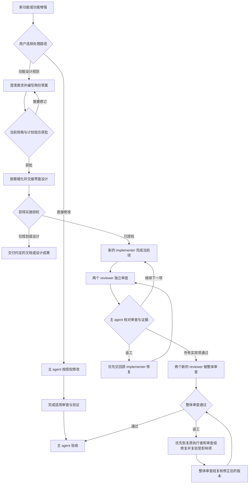

# Harness-AI-Lite · DeepSeek Harness

[DeepSeek Harness English](https://github.com/xuzh0312/Harness-AI-Lite/blob/main/README.dsh.en.md) · [Codex 中文](https://github.com/xuzh0312/Harness-AI-Lite/blob/main/README.codex.zh-CN.md) · [Codex English](https://github.com/xuzh0312/Harness-AI-Lite/blob/main/README.md)

Harness-AI-Lite 是一套可复用的 DeepSeek Harness（DSH）项目模板，将项目管理、软件本体和开发验证材料放在三个独立区域，支持跨目录、跨盘放置。DSH 版与 Codex 版共享核心工作流程，但分派、提问和恢复任务使用 DSH 自身的工具。

**当前版本：2.1.0。** UIUX-design 新增可离线查看的技法图鉴。需要 UI 但尚无具体设计时，先确认强、普通或弱动效，再从素材中挑选方向供用户比较。

## 下载

| 语言 | 模板目录 | ZIP |
| --- | --- | --- |
| 简体中文 | [zh-CN-deepseekharness](zh-CN-deepseekharness/) | [下载中文版 2.1.0 ZIP](https://raw.githubusercontent.com/xuzh0312/Harness-AI-Lite/main/downloads/Harness-AI-Lite-dsh-zh-CN-2.1.0.zip) |
| English | [en-deepseekharness](https://github.com/xuzh0312/Harness-AI-Lite/tree/main/en-deepseekharness) | [Download English 2.1.0 ZIP](https://raw.githubusercontent.com/xuzh0312/Harness-AI-Lite/main/downloads/Harness-AI-Lite-dsh-en-2.1.0.zip) |

每个 ZIP 包含对应模板、同语言指南和 MIT 许可证。旧版安装包见底部[版本记录](#版本记录)。

## 为什么做这个项目

用 agent 开发软件时，除了实现代码，还需要约定怎么理解需求、分派任务、审查改动、处理返工，以及把验证证据存在哪里。本模板把这些约定保存在项目文件里，方便用户审阅范围，给执行者明确的任务边界，也让新会话能根据当前计划和文件恢复工作。

三个区域可以按存储空间、备份方式和访问权限独立安排。例如，规则文档和产品仓库可以各自版本控制，大体积的测试数据放到另一个盘。用路径表将实际位置关联起来。仓库中用来区分语言和运行器的目录用于分发模板。

## 核心设计

| 约定 | 如何工作 |
| --- | --- |
| 三个独立工作区域 | 分开项目管理、软件本体和开发验证材料，在 `harness/docs/paths.md` 记录实际位置。 |
| 功能有两条处理路径 | 用户选择由主 agent 直接修改，或先做功能设计规划。规划路径使用带版本的规格书和编号实现计划。 |
| 分别确认设计与实施 | 已批准的规格书和计划用于记录范围，开始实施还须获得用户授权。界面细化按用户委托进行。 |
| 三类子 agent | UIdesign 与用户协作设计界面，implementer 负责实现和基础设施，reviewer 独立检查规格符合性与实现质量。 |
| 两个独立审查实例 | 对同一版本分别给出结论，主 agent 核对两份报告和实际证据后验收。 |
| 每个跟踪任务一份记录 | 在活动计划中集中保存批准版本、派工、选定的设计、验证、返工和下一步。 |
| 可复用的错误记录 | reviewer 提出按根因整理的条目，主 agent 统一更新知识库。 |
| 模型继承 | DSH 本地 Spawn 继承主 agent 实际使用的 provider、模型和推理深度，派发前核对项目副本中的 `agents/MODELS.md`。 |

## 仓库目录结构

```text
.
├── README.md                   # Codex 英文指南
├── README.codex.zh-CN.md        # Codex 中文指南
├── README.dsh.en.md             # DeepSeek Harness 英文指南
├── README.dsh.zh-CN.md          # DeepSeek Harness 中文指南
├── en-codex/
├── zh-CN-codex/
├── en-deepseekharness/
├── zh-CN-deepseekharness/
└── downloads/
```

每套模板均包含 `harness/`、`project/` 和 `test/`。DSH 中英文模板使用相同的目录结构、角色标识和模型继承规则。一个项目副本选择一套作为规则来源。

## 快速开始

1. 下载并解压 ZIP，或打开本仓库对应模板目录。只复制其中的 `harness`、`project` 和 `test` 到实际项目位置，三个目录可以使用不同的父目录。
2. 在项目副本中填写以下文件，真实项目资料留在副本内。

   | 文件 | 填写内容 |
   | --- | --- |
   | `harness/README.md` | 项目用途、目标用户、范围与已确认的项目细节 |
   | `harness/ARCHITECTURE.md` | 技术栈和架构约束 |
   | `harness/docs/paths.md` | 三个区域的实际绝对路径与目录结构 |

   技术栈已选定时直接记录。尚未选定且希望在功能规划中共同讨论时，选择由主 agent 协助规划。它会使用 [tech-stack-plan](zh-CN-deepseekharness/harness/.agents/skills/tech-stack-plan/SKILL.md) 记录已确认的项目细节和技术选型，再继续功能规划。

3. 条件允许时，将三个区域的共同父目录打开为 DSH 工作区。分别核对各区域的实际读写权限，尤其是跨盘场景。确认本地 Spawn 可以在没有子 agent 覆盖项的情况下继承主 agent 设置。打开工作区或填写路径不会自动加载规则，也不会增加权限。
4. 把**项目副本**的 Harness 入口和第一个任务交给 DSH Desktop。

   ```text
   请读取 <我的 harness 实际绝对路径>/AGENTS.md，按其中规则执行。
   任务：为当前筛选后的列表增加 CSV 导出。
   已有计划：无（有计划时提供编号或路径）。
   ```

   新会话重新提供同一个入口及活动计划。主 agent 会核对当前文件与证据后续接。需一并交接路径、授权和已有证据时，使用[启动模板](zh-CN-deepseekharness/harness/docs/runbooks/start-task-template.md)。

### 接入现有项目

把 `project` 指向包含现有 `code/` 的位置，为 `test` 选择可存放项目测试数据和工具的位置。管理区与软件本体可以属于不同 Git 仓库，先在项目副本的路径表中记录真实路径和目录树，再开展任务。

以 CSV 导出为例，选择规划时可以先明确导出哪些行和列、空结果如何处理、用户如何打开文件。选择直接修改时，主 agent 根据你授权的范围实现，并验证受影响行为。续接已有任务时，提供计划编号或路径，并说明相关文件的当前状态。

从 DSH 1.0.0 升级时，先核对活动计划、角色分派和路径再替换规则。保留既有任务记录，按 [迁移清单](zh-CN-deepseekharness/harness/docs/runbooks/dsh-migration.md) 核对运行器细节。

## 选择功能处理方式

遇到新功能或功能增强时，主 agent 会请你在两条路径中选择。

| 路径 | 执行方式 |
| --- | --- |
| 由主 agent 直接修改 | 在授权范围内修改并完成适用的审查与验证，无需新建功能规格书和实现计划。 |
| 功能设计规划 | 主 agent 通过 [feature-plan](zh-CN-deepseekharness/harness/.agents/skills/feature-plan/SKILL.md) 逐题明确需求，一起展示各自带版本的规格书和编号实现计划。你确认当前组合并授权后，才开始实施。 |

涉及界面时，先通过 [UIUX-design](zh-CN-deepseekharness/harness/.agents/skills/UIUX-design/README.md) 在规划中明确用户任务、必要功能和恢复路径。组合获批后，如你委托界面细化，UIdesign 会与你确认代表页面，并沿选定方向细化关键页面。UIdesign 将问题交给主 agent，由主会话向你提问，再把你的原始回答转交设计实例。项目设计稿、原型与走查证据放在 `test`。

### 执行与验收



获批且获准实施的计划按[逐项执行流程](zh-CN-deepseekharness/harness/.agents/skills/subagent-driven-execution/SKILL.md)推进。返工优先交回原执行者和原审查组。并发容量不足时，两个 reviewer 保持独立上下文顺序审查，并记录实际执行方式。强制审查的验收必须取得同一最终版本的两份结论和所需验证证据。即使选择直接修改，代码、基础设施和影响后续决策的规则改动也需要两个 reviewer。

### 修订与恢复

功能规格书与计划共用一个 `PLAN` 编号，各自保留版本。范围、用户行为、关键技术方案或验收标准发生实质变化时，要修订并重新确认当前组合，受影响的实现暂停。更正文字、记录进度或移动已结束的计划时，仍有效的原批准可以继续使用。

需要跟踪的任务在 `harness/docs/plans/active/` 保留一份活动计划。完成或取消后将计划归档到 `completed/`，规格书保留在 `docs/specs/` 并更新链接。计划记录受审版本、验证结果和下一步，原始验证材料留在 `test`，计划中保留引用。

## DSH 专用流程

- **派发与模型继承。** 使用本地 DSH `subagent`（Spawn），不配置子 agent 路由或推理深度覆盖，并省略 `provider`、`model`、`reasoning_effort`，以继承主 agent 的实际设置。核对当前 profile；不符合继承或禁用模型规则时报告阻塞。只记录运行时可见的实际值，不猜测隐藏设置。见 [MODELS.md](zh-CN-deepseekharness/harness/agents/MODELS.md)。
- **项目内流程。** 用 `read` 读取[项目流程索引](zh-CN-deepseekharness/harness/.agents/skills/README.md)及对应文件，不依赖原生技能注册；DSH 原生技能仍使用 `skill` 加载。
- **规划与 UI 设计。** [feature-plan](zh-CN-deepseekharness/harness/.agents/skills/feature-plan/SKILL.md) 用于澄清需求并形成规格书与实现计划。涉及界面时，[UIUX-design](zh-CN-deepseekharness/harness/.agents/skills/UIUX-design/README.md) 先梳理用户任务和必要功能。UIdesign 把问题交给主 agent，由主会话优先用 `ask_user_question` 提问，不可用时改用对话，再回传答案。用户跳过或留空时，继续独立工作，只暂缓依赖答案的决策；跳过不代表批准。
- **执行与恢复。** 计划获批且获得实施授权后，串行执行计划项。每项使用新的执行者上下文及两个独立 reviewer，整体审查再新建 reviewer。记录子 agent 的名称，使用 `list_agents` 和 `send_message` 恢复；原实例无法恢复或主 agent 设置已变更时，创建新实例并交接已核实的信息。`inactive` 不代表通过。

完整流程与部署限制见[主 agent 执行手册](zh-CN-deepseekharness/harness/docs/runbooks/main-agent.md)和 [DSH 迁移清单](zh-CN-deepseekharness/harness/docs/runbooks/dsh-migration.md)。迁移清单以 DSH Desktop `0.2.2-rc.5` 为目标环境；模板不改全局配置，也不安装插件。

## 内置角色与技能

| 角色 | 职责 |
| --- | --- |
| [UIdesign](zh-CN-deepseekharness/harness/agents/UIdesign/AGENT.md) | 与用户讨论界面取舍，交接设计成果和待验证状态。 |
| [implementer](zh-CN-deepseekharness/harness/agents/implementer/AGENT.md) | 实现并验证改动，执行基础设施、构建和已授权的打包任务。 |
| [reviewer](zh-CN-deepseekharness/harness/agents/reviewer/AGENT.md) | 以 `reviewer-spec` 和 `reviewer-quality` 两个只读实例审查同一个最终版本。 |

| 技能 | 适用场景 |
| --- | --- |
| [feature-plan](zh-CN-deepseekharness/harness/.agents/skills/feature-plan/SKILL.md) | 访谈、检查需求覆盖，将规格书与实现计划一并交给用户确认。 |
| [tech-stack-plan](zh-CN-deepseekharness/harness/.agents/skills/tech-stack-plan/SKILL.md) | 技术栈尚未选定且用户选择共同规划时，更新项目简介与技术栈文档。 |
| [UIUX-design](zh-CN-deepseekharness/harness/.agents/skills/UIUX-design/README.md) | 梳理用户任务，细化代表页面、关键状态和恢复路径。静态稿无法验证关键操作时，按需制作最小交互原型。 |
| [subagent-driven-execution](zh-CN-deepseekharness/harness/.agents/skills/subagent-driven-execution/SKILL.md) | 执行已授权的计划，逐项派工、双审查、返工复核和整体审查。 |
| [bug-detect](zh-CN-deepseekharness/harness/.agents/skills/bug-detect/SKILL.md) | 确认缺陷或复验修复时查找同类问题。由 reviewer 提议记录，主 agent 按根因去重后写入。 |

主 agent 用 `read` 读取 `harness/.agents/skills/` 中的项目流程，按任务需要创建角色。这些文件无需注册为 DSH 原生技能；原生技能仍通过 `skill` 加载。设计访谈默认只读，需要制作稿件或原型时，由主 agent 在 `test` 下指定可写位置，再把选定的设计与适用验收项关联起来。

## 文件放在哪里

| 区域 | 存放内容 |
| --- | --- |
| `harness` | 项目规则、文档、技能、规格、计划、决策与错误知识库。可复用的 UIUX-design 参考资料随技能分发。 |
| `project/code` | 软件本体源码、必要运行与构建文件、属于交付软件的启动文件。 |
| `project/installpark` | 用户明确要求或批准计划中打包项后生成的最终 ZIP 安装包。 |
| `test` | 测试、辅助工具、数据、原始日志、缓存、普通构建输出、项目稿件、原型与验证证据。 |

软件源码可以编译后进入交付物。构建与打包辅助脚本、中间产物及用于核对安装包的解压文件放在 `test`。工具要求固定目录且与边界冲突时，由主 agent 报告具体路径并请用户决定。

## 模板文档

| 文档 | 用途 |
| --- | --- |
| [AGENTS.md](zh-CN-deepseekharness/harness/AGENTS.md) | 项目运行入口与工作规则 |
| [ARCHITECTURE.md](zh-CN-deepseekharness/harness/ARCHITECTURE.md)、[路径表](zh-CN-deepseekharness/harness/docs/paths.md) | 技术栈、文件边界和实际目录索引 |
| [主 agent 手册](zh-CN-deepseekharness/harness/docs/runbooks/main-agent.md)、[启动模板](zh-CN-deepseekharness/harness/docs/runbooks/start-task-template.md) | 分派、验收证据和新会话入口 |
| [角色协议](zh-CN-deepseekharness/harness/agents/README.md)、[交接模板](zh-CN-deepseekharness/harness/agents/TASK_TEMPLATE.md) | 角色职责、可写范围和分派输入 |
| [模型配置](zh-CN-deepseekharness/harness/agents/MODELS.md)、[技能索引](zh-CN-deepseekharness/harness/.agents/skills/README.md) | 模型继承、派发限制与项目流程入口 |
| [规格模板](zh-CN-deepseekharness/harness/docs/specs/TEMPLATE.md)、[计划模板](zh-CN-deepseekharness/harness/docs/plans/TEMPLATE.md) | 版本化需求和可跟踪的实现清单 |
| [错误知识库](zh-CN-deepseekharness/harness/docs/bugs.md)、[设计决策](zh-CN-deepseekharness/harness/docs/decisions/README.md)、[技术债](zh-CN-deepseekharness/harness/docs/tech-debt.md) | 可供后续任务查询的记录 |

## Git 与交付约定

- 部署后的 `harness` 和 `project/code` 使用独立 Git 仓库，通过任务编号与版本关联。没有 Git 的区域可记录前置快照并比对内容。
- 初始化、提交、推送、合并和发布按任务授权执行。交付时记录真正执行的验证，注明尚未运行的检查。
- `project/installpark` 仅保存明确授权生成的最终 ZIP 安装包。普通构建和测试通过不会触发打包。核对归档格式和内容，同版本有效的功能验证可复用。
- 使用前核对目标环境的工具能力与目录权限。模板和 ZIP 的静态检查覆盖分发文件，项目运行情况取决于实际项目、运行器和模型。

## 设计参考与参与改进

需求访谈参考 GrillMe，逐项执行与独立审查参考 Superpowers。模板自带使用协议，这两个插件均可选装。

欢迎通过 Issue 反馈规则冲突、部署问题或遗漏。改进模板规则时，同步同一运行器的中英文版，保持角色配置、编号和工作区域边界一致。真实项目资料、任务历史及运行产物留在项目副本中。

## 实机验证

**DeepSeek Harness 2.0.0 已在 DSH Desktop 中跑通完整的端到端流程。** 这项验证覆盖实测环境，不代表所有 Desktop 版本、profile、模型提供方或跨盘工作区均已验证。部署到不同环境时，请重新确认 Spawn 继承设置、目录权限和所需工具。

## 许可证

本项目采用 [MIT License](LICENSE)。复制或分发模板及其重要部分时，请保留版权和许可证声明。

## 版本记录

| 版本 | 日期 | 说明 | 下载 |
| --- | --- | --- | --- |
| 2.1.0 | 2026/11/22 | 强化 UIUX-design 技能，提供具体素材选择。 | [中文 ZIP](https://raw.githubusercontent.com/xuzh0312/Harness-AI-Lite/main/downloads/Harness-AI-Lite-dsh-zh-CN-2.1.0.zip) · [English ZIP](https://raw.githubusercontent.com/xuzh0312/Harness-AI-Lite/main/downloads/Harness-AI-Lite-dsh-en-2.1.0.zip) |
| 2.0.0 | 2026/11/22 | 调整子 Agent 的角色分工与技能（Skill），新增 UIdesign 角色和 UI 设计流程。 | [中文 ZIP](https://raw.githubusercontent.com/xuzh0312/Harness-AI-Lite/main/downloads/Harness-AI-Lite-dsh-zh-CN-2.0.0.zip) · [English ZIP](https://raw.githubusercontent.com/xuzh0312/Harness-AI-Lite/main/downloads/Harness-AI-Lite-dsh-en-2.0.0.zip) |
| 1.0.0 | 2026/11/17 | 初版采用轻量化 Harness 工程模板，将管理、软件与测试分置于三个独立工作区，提供需求确认、分工实现、双重审查和基于证据的验收流程。 | [中文 ZIP](https://raw.githubusercontent.com/xuzh0312/Harness-AI-Lite/main/downloads/Harness-AI-Lite-dsh-zh-CN-1.0.0.zip) · [English ZIP](https://raw.githubusercontent.com/xuzh0312/Harness-AI-Lite/main/downloads/Harness-AI-Lite-dsh-en-1.0.0.zip) |
