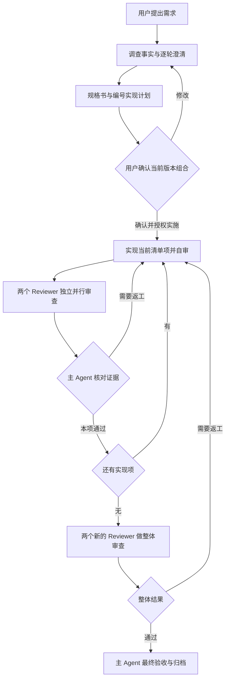

# Harness-AI-Lite · DeepSeek Harness

**将 harness 管理区、project 软件区与 test 测试区独立开，让 AI 开发更方便，让项目保持干净整洁。**

[Codex 中文](README.codex.zh-CN.md) · [Codex English](README.md) · [DeepSeek Harness English](README.dsh.en.md) · [快速开始](#快速开始)

Harness-AI-Lite 是一套轻量化的 Harness 工程模板，开发时借鉴了 GrillMe 和 Superpowers 的思路。你只需复制目录、填写项目介绍、技术栈和实际路径，就可以让主 Agent 按统一流程组织需求分析、实现、审查、返工和交付。

它适合希望为不同项目复用开发规范的个人开发者和小型团队，尤其适合管理文档、软件代码及测试材料需要分盘存放的工作区。模板不绑定具体编程语言、框架或软件类型。本指南适用于旧版 DeepSeek Harness 模板。它采用四角色流程与 DeepSeek 的模型路由。DeepSeek Harness 版的端到端运行尚未验证。

## 最关键的设计：三个区域独立放置

Harness-AI-Lite 的核心是将 **harness、project、test 三个区域独立开**。它们可以放在不同目录、不同磁盘，无需共同父目录；在 `harness/docs/paths.md` 中填写实际路径即可建立关联。

- **harness 管理区**：集中保存规则、需求、计划、决策和简要日志，便于查看与恢复任务。
- **project 软件区**：保存软件本体及明确授权生成的最终安装包，让产品目录保持清晰。
- **test 测试区**：集中收纳测试代码、辅助工具、数据、原始日志、缓存和中间产物，避免开发杂物堆入产品目录。

这种分离既方便用户按磁盘空间、备份和工作习惯安排目录，也让文档、软件与验证材料各有归处。仓库中的语言目录只是分发容器，部署后无需保留这一共同目录结构。

## 下载

| 版本 | ZIP 下载 |
| --- | --- |
| DeepSeek Harness 中文 | [Harness-AI-Lite-zh-CN-deepseekharness.zip](https://github.com/xuzh0312/Harness-AI-Lite/raw/refs/heads/main/downloads/Harness-AI-Lite-zh-CN-deepseekharness.zip) |
| DeepSeek Harness English | [Harness-AI-Lite-en-deepseekharness.zip](https://github.com/xuzh0312/Harness-AI-Lite/raw/refs/heads/main/downloads/Harness-AI-Lite-en-deepseekharness.zip) |

每个压缩包包含对应运行器和语言的模板、使用说明和 MIT 许可证。解压后，将其中的 `harness`、`project`、`test` 分别复制到所需位置，再填写项目介绍、技术栈和路径即可开始配置。压缩包发布在仓库的 `downloads/` 目录。

## 为什么做这个项目

在 Agent 辅助开发中，写出代码只是其中一步。需求是否被正确理解、任务如何分派、谁来检查实现、失败后如何继续，以及验证依据存在哪里，同样需要明确。

同时AI开发时总是把所有数据都堆在工作目录，新手经常理不清项目文件因此这个项目特意将其进行了区分。

本项目把这些约定保存在项目文件中，让用户可以审阅方案，让执行者获得明确边界，也让新会话能够根据已有记录恢复工作。它提供的是可检查的协作协议，不是后台调度服务，也不保证任意模型自动遵循全部规则。

## 核心设计

| 设计 | 如何工作 |
| --- | --- |
| 三个独立工作区域 | harness 保存管理资料，project 保存软件本体及明确授权的安装包，test 保存测试与所有非本体开发材料 |
| 先确认再实现 | 主 Agent 逐轮澄清需求，同步整理规格书和编号计划，一起展示并取得当前版本组合的批准 |
| 四类子 Agent 角色 | architect 分析方案，implementer 实现，infra 处理基础设施，reviewer 独立审查 |
| 两个并行审查实例 | reviewer-spec 检查规格符合性，reviewer-quality 检查实现质量；逐项及最终整体审查都使用两实例 |
| 按证据验收 | 记录实际检查、覆盖版本与限制；失败或未运行的必需检查不能标为通过 |
| 可恢复的任务记录 | 一个功能保留一份活动计划，集中保存批准、派工、交付摘要、返工和下一步 |
| 可复用的错误知识库 | 确认缺陷按根因去重，记录解决方案、适用范围及验证证据 |
| 集中的模型设置 | 子 Agent 的模型与推理深度只从所选副本的 MODELS.md 读取 |

## 工作流程



主 Agent 统一组织对话、分派任务、维护共享记录和最终验收。子 Agent 不嵌套创建其他 Agent，也不直接修改共享进度或错误知识库。

两个 Reviewer 必须分别给出结论，并覆盖同一最终版本。并发容量不足时可以顺序运行两个独立实例，但不能合并成一个；任一报告缺失、需返工或证据不足时，不能验收通过。

## 目录结构

```text
.
├── README.md
├── README.codex.zh-CN.md
├── README.dsh.en.md
├── README.dsh.zh-CN.md
├── zh-CN-codex/
├── en-codex/
├── zh-CN-deepseekharness/
└── en-deepseekharness/
    # 每套均包含： harness/ + project/ + test/
```

DeepSeek Harness 的中英文模板采用同一套技能、角色、编号与模型路由配置。每个项目选择其中一套作为规则来源。

| 区域 | 放什么 |
| --- | --- |
| harness | 项目介绍、技术栈、规则、角色与技能说明、规格、计划、决策、错误知识库和简要日志文档 |
| project/code | 交付软件本体的实现、运行资源，以及必要项目描述、依赖清单和构建配置 |
| project/installpark | 用户明确要求或明确批准计划中的打包项后生成的最终安装包 |
| test | 所有非本体代码，包括测试、验证及打包辅助脚本，以及数据、原始日志、截图、缓存、中间产物和非安装包输出 |

软件本体代码可以编译后进入产品；不要求源文件原样进入安装包。测试或工具代码不会因为参与构建而成为软件本体。工具固定目录与上述边界冲突时，需要明确报告并由用户决定。

## 快速开始

### 1. 获取模板并选择语言

下载上方对应语言的 ZIP 并解压，或克隆 / Fork 本仓库。从 `zh-CN-deepseekharness/` 或 `en-deepseekharness/` 中选择一套，复制 `harness`、`project`、`test` 到实际项目所需位置。

三个目录可以位于不同磁盘，无需共同父目录。每个项目使用自己的副本，不共用计划和错误记录。

### 2. 填写三份文件

在项目副本中替换 `@@`，不要把真实项目资料写回干净模板。

| 文件 | 填写内容 |
| --- | --- |
| harness/README.md | 项目用途、目标用户、功能范围及约束 |
| harness/ARCHITECTURE.md | 技术栈、目标平台、交付形式和架构约束 |
| harness/docs/paths.md | harness、project、test 的实际绝对路径 |

未知技术选择可以注明待定，再通过需求讨论明确。规格书、实现计划、决策和错误记录由主 Agent 根据实际任务维护，无需用户预先填完整套文档。

### 3. 配置运行环境

运行器需要能够读取 Markdown、访问三个实际目录、创建独立子 Agent，并在创建时显式设置模型和推理深度。

检查所选副本的 `harness/agents/MODELS.md` 是否适用于当前运行器。使用 `list_subagent_models` 核对路由，并显式传入 provider、model 和 reasoning_effort。两个 Reviewer 共用 reviewer 配置，每个实例分别记录实际参数；主 Agent 的模型由运行器控制。

模板中的角色和技能通过主 Agent 显式读取，不是运行器的原生配置。打开多个工作区目录不等于自动加载规则或获得权限；缺少必要能力时应报告阻塞，不能假装执行或审查已经完成。

### 4. 提交第一个任务

在对话中发送：

```text
请读取 <harness 实际绝对路径>/AGENTS.md，
按其中规则执行本项目任务：

<用简单语言描述功能或问题>

已有计划：<无，或提供计划编号/路径>
```

例如，你可以提出“为现有列表增加 CSV 导出功能”，由 Agent 调查已有实现并澄清导出范围、格式和边界行为。随后审阅它生成的规格书、计划版本及完整编号清单，再明确确认是否开始实施。

新会话重新提供入口和已有计划。仅要求规划时不会自动实施；实质变更需要修订确认，错字修改和仍有效的批准无需重复确认。使用英文规则时也可以指定对话语言。

## 内置技能与角色

| 技能 | 作用 |
| --- | --- |
| [feature-plan](zh-CN-deepseekharness/harness/.agents/skills/feature-plan/SKILL.md) | 逐轮需求访谈、规格书、自动编号计划、用户确认与修订 |
| [subagent-driven-execution](zh-CN-deepseekharness/harness/.agents/skills/subagent-driven-execution/SKILL.md) | 已批准计划的逐项派工、双 Reviewer、返工、恢复与最终验收 |
| [bug-detect](zh-CN-deepseekharness/harness/.agents/skills/bug-detect/SKILL.md) | 检索历史缺陷、按根因去重，以及复核修复方案 |

技能位于 `harness/.agents/skills/`，不需要全局安装，也不保证被运行器自动发现。纯问答、轻微文字调整及按既有契约修复缺陷，不强制新增功能规格和计划。

| 角色 | 主要职责 |
| --- | --- |
| architect | 只读调查、方案分析、边界、依赖及验收建议 |
| implementer | 当前分配项的实现、测试、自审和针对性验证 |
| infra | 环境、依赖工具、构建、CI 及明确授权的打包 |
| reviewer | 两个独立只读实例分别审查规格符合性和实现质量 |

详细职责、读写边界和交接格式见[角色协议](zh-CN-deepseekharness/harness/agents/README.md)。不会为了凑齐角色而创建没有实际任务的子 Agent。

## 文档导航

| 文档 | 中文 | English |
| --- | --- | --- |
| 运行入口 | [AGENTS.md](zh-CN-deepseekharness/harness/AGENTS.md) | [AGENTS.md](en-deepseekharness/harness/AGENTS.md) |
| 架构与文件边界 | [ARCHITECTURE.md](zh-CN-deepseekharness/harness/ARCHITECTURE.md) | [ARCHITECTURE.md](en-deepseekharness/harness/ARCHITECTURE.md) |
| 模型配置 | [MODELS.md](zh-CN-deepseekharness/harness/agents/MODELS.md) | [MODELS.md](en-deepseekharness/harness/agents/MODELS.md) |
| 主 Agent 手册 | [执行手册](zh-CN-deepseekharness/harness/docs/runbooks/main-agent.md) | [Execution handbook](en-deepseekharness/harness/docs/runbooks/main-agent.md) |
| 详细启动模板 | [启动模板](zh-CN-deepseekharness/harness/docs/runbooks/start-task-template.md) | [Task starter](en-deepseekharness/harness/docs/runbooks/start-task-template.md) |
| 需求规格 | [规格模板](zh-CN-deepseekharness/harness/docs/specs/TEMPLATE.md) | [Specification template](en-deepseekharness/harness/docs/specs/TEMPLATE.md) |
| 执行计划 | [计划模板](zh-CN-deepseekharness/harness/docs/plans/TEMPLATE.md) | [Plan template](en-deepseekharness/harness/docs/plans/TEMPLATE.md) |
| 错误知识库 | [bugs.md](zh-CN-deepseekharness/harness/docs/bugs.md) | [bugs.md](en-deepseekharness/harness/docs/bugs.md) |
| 技能目录 | [技能说明](zh-CN-deepseekharness/harness/.agents/README.md) | [Skills](en-deepseekharness/harness/.agents/README.md) |

同一功能的规格书与计划共用 PLAN 编号，实现项和验收场景分别使用稳定编号。活动计划放 `docs/plans/active/`，完成或取消后归档到 `completed/`；规格书保留原位并更新引用。设计决策和实际技术债分别放 `docs/decisions/`、`docs/tech-debt.md`。

Reviewer 确认缺陷或复验时调用 bug-detect，由主 Agent 去重后统一写入 `docs/bugs.md`。知识库不是自动异常采集器；原始运行日志和复现代码放 test，同根因复发更新原条目，验证后才记录已解决。

## Git 与交付约定

- 目标项目的 harness 与 project/code 分别使用独立 Git 仓库，不要求三个区域共有根仓库。
- test 与安装包独立保存；没有 Git 的区域可以通过前置快照与内容比对提供审查依据。
- 初始化、提交、推送、合并和发布按实际任务授权执行，验收通过不会自动授权这些操作。
- 普通构建、测试通过或功能完成不自动触发打包；只有明确要求或批准的打包项才生成最终安装包。
- 本地检查不能替代目标环境验收，交付时需要说明实际验证及未验证限制。

## 设计参考与参与改进

需求访谈方式参考 GrillMe，逐项执行与审查流程参考 Superpowers。所需协议已包含在模板内，无需另外安装这两个插件；本项目是独立整理的模板，不是它们的官方发行版。

欢迎通过 Issue 反馈规则冲突、部署问题或遗漏，通过 Pull Request 改进模板。修改规则含义时请同步中英文版本，保持结构、模型参数和编号约定一致，不提交真实项目资料、任务历史或运行产物。

模板已完成静态检查，但尚不代表每一种运行器和技术栈都已完成端到端验证。使用前请核对工具能力、权限和模型参数支持。

## 许可证

本项目采用 [MIT License](LICENSE)。允许使用、修改、分发及商用，复制或分发本模板及其重要部分时须保留版权与许可证声明；具体条款以 LICENSE 为准。

## 版本记录

| 版本 | 日期 | 说明 |
| --- | --- | --- |
| 1.0.0 | 2026/11/17 | 初版采用轻量化 Harness 工程模板，将管理、软件与测试分置于三个独立工作区，提供需求确认、分工实现、双重审查和基于证据的验收流程。 |
