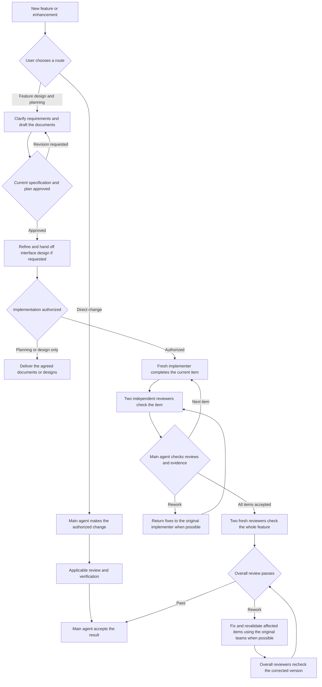

# Harness-AI-Lite · Codex

[Codex 中文](README.codex.zh-CN.md) · [DeepSeek Harness English](README.dsh.en.md) · [DeepSeek Harness 中文](README.dsh.zh-CN.md)

Harness-AI-Lite is a reusable project template for Codex. It keeps project management, product code, and development evidence in three independently located directories. The template works with your project's existing language and stack, and its conventions apply even when the three directories are on different disks.

## Download

| Language | Template directory | ZIP |
| --- | --- | --- |
| English | [en-codex](en-codex/) | [Download English ZIP](https://github.com/xuzh0312/Harness-AI-Lite/raw/refs/heads/main/downloads/Harness-AI-Lite-en-codex.zip) |
| 简体中文 | [zh-CN-codex](zh-CN-codex/) | [下载中文版 ZIP](https://github.com/xuzh0312/Harness-AI-Lite/raw/refs/heads/main/downloads/Harness-AI-Lite-zh-CN-codex.zip) |

Each ZIP contains the selected template, a guide in the same language, and the MIT license. For the earlier DeepSeek Harness workflow and its downloads, see the [DeepSeek Harness guide](README.dsh.en.md).

## Why this project exists

Agent-assisted development includes decisions about requirements, delegation, review, recovery, and where to retain verification evidence. Keeping those decisions in project files lets users review the proposed scope, gives implementers a record of their assignment, and lets a new session resume from the current plan and files.

The three areas can be arranged separately for storage, backups, and permissions. A project can keep the Harness rules in one location, the product repository in another, and large test data on a separate disk. The path table links those locations. The directories that group the templates in this repository serve as distribution containers.

## Core design

| Convention | How it works |
| --- | --- |
| Three independent work areas | Separate project management, the delivered software, and development evidence. Record their actual locations in `harness/docs/paths.md`. |
| Two routes for new features | Choose a direct change by the main agent or feature design and planning. The planning route uses a versioned specification and a numbered implementation plan. |
| Separate design and implementation authorization | The approved specification and plan record the agreed scope. Starting implementation also requires user authorization. Interface work follows the user's design instructions. |
| Three subagent roles | UIdesign works with the user on interface design, implementer handles code and infrastructure, and reviewer checks conformance and implementation quality. |
| Two independent review instances | Reviewers report separately on the same version. The main agent checks both conclusions and the verification evidence before accepting the work. |
| One record per tracked task | The active plan keeps the approved document versions, assignments, selected designs, checks, rework, and next step together. |
| Reusable defect records | Reviewers propose entries keyed by root cause, and the main agent keeps the centralized record current. |
| Central model configuration | Every subagent uses the matching role in the selected copy's `agents/MODELS.md`. |

## Repository structure

```text
.
├── README.md                   # Codex English
├── README.codex.zh-CN.md        # Codex Chinese
├── README.dsh.en.md             # DeepSeek Harness English
├── README.dsh.zh-CN.md          # DeepSeek Harness Chinese
├── en-codex/
├── zh-CN-codex/
├── en-deepseekharness/
├── zh-CN-deepseekharness/
└── downloads/
```

Each template edition contains `harness/`, `project/`, and `test/`. The two Codex languages share the same structure, role identifiers, and model settings. Use one edition as the rule source for a deployed project.

## Quick start

1. Download and extract a ZIP or use the matching directory in this repository. Copy only `harness`, `project`, and `test` to the locations you want to use. They can have different parent directories.
2. Fill in the following files in your project copy. Keep the distribution template clean.

   | File | What to record |
   | --- | --- |
   | `harness/README.md` | Project purpose, intended users, scope, and confirmed project details |
   | `harness/ARCHITECTURE.md` | Technology stack and architecture constraints |
   | `harness/docs/paths.md` | Actual absolute paths and directory layout for all three areas |

   If the stack is already selected, record it. If you want to select it during feature planning, choose to discuss it with the main agent. It uses [tech-stack-plan](en-codex/harness/.agents/skills/tech-stack-plan/SKILL.md) to record confirmed project details and stack choices, then resumes feature planning.

3. Verify that Codex can read the entry file, access the required directories, and create independent subagents with explicit `model` and `reasoning_effort` values from [MODELS.md](en-codex/harness/agents/MODELS.md). The main agent explicitly reads the bundled roles and skills. Opening directories in a workspace does not load those rules or grant additional permissions.
4. Give Codex the path to the **copied** Harness entry and your first task.

   ```text
   Read <absolute path to my harness>/AGENTS.md and follow it for this task.
   Task: Add CSV export for the currently filtered list.
   Existing plan: none (or provide the plan ID or path).
   ```

   In a new session, provide the same entry and any active plan. The main agent checks the current files and evidence before resuming.

### Starting from an existing project

Point `project` at the location that contains your existing `code/` directory and set `test` to a location that can hold the project's test data and tooling. The Harness and product repositories can have different roots. Record the real paths and tree in the project copy before making changes.

For the CSV example, the planning route can clarify which rows and columns to export, how to handle an empty result, and how the user opens the output. In the direct-change route, the main agent uses the scope you authorize and verifies the affected behavior. For a task that is already in progress, give the plan ID or path and the current state of the relevant files.

## Choose how to handle a feature

For a new feature or enhancement, the main agent asks you to choose one of these paths.

| Path | What happens |
| --- | --- |
| Direct change | The main agent makes the authorized change and completes the applicable reviews and checks. This path skips a new feature specification and implementation plan. |
| Feature design and planning | The main agent uses [feature-plan](en-codex/harness/.agents/skills/feature-plan/SKILL.md) to clarify requirements one question at a time, then presents the versioned specification and numbered implementation plan together for approval. Implementation starts once the document pair is approved and you authorize implementation. |

For interface work, [UIUX-design](en-codex/harness/.agents/skills/UIUX-design/README.md) helps clarify user tasks, essential features, and recovery paths during planning. After approval, if you ask for interface design, UIdesign works with you on a representative screen and refines the key pages in the chosen direction. It can ask you directly where Codex supports it or relay questions through the main agent. Project mockups, prototypes, and design-review evidence belong in `test`.

### Execution and acceptance



An approved and authorized plan proceeds [one item at a time](en-codex/harness/.agents/skills/subagent-driven-execution/SKILL.md). Prefer returning rework to the original implementer and review instances. When the runner has limited concurrency, run both reviewers sequentially in independent contexts and record that they were sequential. Mandatory acceptance needs both conclusions covering the same final version and the required evidence. Code, infrastructure, and rule changes that affect later decisions also require two independent reviews when using the direct route.

### Changes and resumption

The specification and plan share a `PLAN` ID and have independent versions. Material changes to scope, user behavior, key technical decisions, or acceptance criteria require revising and approving the current pair. During execution, pause affected implementation until that approval is in place. An unchanged approval remains valid when correcting wording, recording progress, or moving a finished plan.

Work tracked in a plan stays in `harness/docs/plans/active/` while open. After finishing or cancelling, archive the plan in `completed/` and keep the specification in `docs/specs/` with current links. Record the relevant versions, results, and next step. Keep raw evidence in `test` and references in the plan.

## Bundled roles and skills

| Role | Responsibility |
| --- | --- |
| [UIdesign](en-codex/harness/agents/UIdesign/AGENT.md) | Discusses interface decisions with the user and hands off designs and open states. |
| [implementer](en-codex/harness/agents/implementer/AGENT.md) | Implements and verifies changes, including infrastructure, builds, and authorized packaging. |
| [reviewer](en-codex/harness/agents/reviewer/AGENT.md) | Runs as two read-only instances, `reviewer-spec` and `reviewer-quality`, covering the same final version. |

| Skill | When to use it |
| --- | --- |
| [feature-plan](en-codex/harness/.agents/skills/feature-plan/SKILL.md) | Run the feature interview, check requirements coverage, and present a specification and implementation plan together. |
| [tech-stack-plan](en-codex/harness/.agents/skills/tech-stack-plan/SKILL.md) | Work through an undecided stack if the user chooses joint planning, then update the project overview and architecture. |
| [UIUX-design](en-codex/harness/.agents/skills/UIUX-design/README.md) | Clarify user tasks and shape representative pages, key states, and recovery paths. Add a minimal interactive prototype when a static design cannot answer the interaction question. |
| [subagent-driven-execution](en-codex/harness/.agents/skills/subagent-driven-execution/SKILL.md) | Execute authorized plans item by item, including dual review, rework, and overall review. |
| [bug-detect](en-codex/harness/.agents/skills/bug-detect/SKILL.md) | Look up related defects when confirming an issue or checking a fix. Reviewers propose an entry or update and the main agent writes the deduplicated record. |

The main agent loads skills from `harness/.agents/skills/` and creates roles as the task requires. A design interview is read-only by default. The main agent assigns a writable location under `test` for drafts or prototypes and links the selected design to applicable acceptance criteria.

## Where files go

| Area | Contents |
| --- | --- |
| `harness` | Project rules, documentation, skills, specifications, plans, decisions, and the defect knowledge base. Reusable UIUX-design references ship here. |
| `project/code` | Product source, required runtime and build files, and launch files that are part of the delivered software. |
| `project/installpark` | Final ZIP installers when explicitly requested or included in a user-approved packaging task. |
| `test` | Tests, helper tools, data, logs, cache, ordinary build output, project design files, prototypes, and verification evidence. |

Source files can be compiled into the deliverable. Keep build and packaging helper scripts in `test`, along with intermediate artifacts and archive extraction used for verification. If a tool requires a fixed directory that conflicts with these boundaries, report the conflict and ask the user to decide.

## Template reference

| Document | Use |
| --- | --- |
| [AGENTS.md](en-codex/harness/AGENTS.md) | Entry point and project working rules |
| [ARCHITECTURE.md](en-codex/harness/ARCHITECTURE.md) and [paths.md](en-codex/harness/docs/paths.md) | Stack, file placement, and directory index |
| [Main agent handbook](en-codex/harness/docs/runbooks/main-agent.md) and [task starter](en-codex/harness/docs/runbooks/start-task-template.md) | Dispatch, evidence, and session setup |
| [Role protocol](en-codex/harness/agents/README.md) and [handoff template](en-codex/harness/agents/TASK_TEMPLATE.md) | Work boundaries and inputs for delegation |
| [MODELS.md](en-codex/harness/agents/MODELS.md) and [skill index](en-codex/harness/.agents/skills/README.md) | Model parameters and reading order |
| [Specification template](en-codex/harness/docs/specs/TEMPLATE.md) and [plan template](en-codex/harness/docs/plans/TEMPLATE.md) | Versioned requirements and trackable implementation |
| [Defect knowledge base](en-codex/harness/docs/bugs.md), [decisions](en-codex/harness/docs/decisions/README.md), and [technical debt](en-codex/harness/docs/tech-debt.md) | Persistent records for later tasks |

## Git and delivery

- In deployed projects, `harness` and `project/code` use independent Git repositories. Relate their changes by task ID and version. For areas without Git, record a baseline snapshot and compare content.
- Repository initialization, commits, pushes, merges, and publishing require authorization. Keep evidence of the work actually performed and identify unrun checks during delivery.
- Store only explicitly authorized final ZIP installers in `project/installpark`. Ordinary builds and passing tests do not trigger packaging. Verify the archive layout and contents and reuse valid functional checks for the same version.
- Verify runtime capabilities and permissions for your environment. The template checks and package inspection cover the distribution files, while deployed behavior depends on the actual project, runner, and model.

## Design references and contributions

The interview approach draws on GrillMe. Item-by-item execution and independent review draw on Superpowers. The template includes its own protocols. Both plugins are optional.

Use Issues for rule conflicts, deployment problems, or gaps. When proposing a template change, synchronize rule meaning across both language variants for the affected runner and preserve role settings, identifiers, and boundaries. Keep real project data, task history, and runtime artifacts out of changes to the distribution template.

## License

The project uses the [MIT License](LICENSE). Keep the copyright and license notices when distributing the template or substantial portions of it.

## Version history

| Version | Date | Description | Downloads |
| --- | --- | --- | --- |
| 2.0.0 | 2026/11/21 | Revises subagent responsibilities and skills, and adds the UIdesign role and a UI design workflow. | [中文 ZIP](https://raw.githubusercontent.com/xuzh0312/Harness-AI-Lite/8e42dd79b925b111b79769bdff954d39a778729d/downloads/Harness-AI-Lite-zh-CN-codex.zip) · [English ZIP](https://raw.githubusercontent.com/xuzh0312/Harness-AI-Lite/8e42dd79b925b111b79769bdff954d39a778729d/downloads/Harness-AI-Lite-en-codex.zip) |
| 1.0.0 | 2026/11/17 | The first release introduces a lightweight Harness Engineering template with separate management, software, and test workspaces, plus a workflow for requirements approval, delegated implementation, dual review, and evidence-based acceptance. | [中文 ZIP](https://raw.githubusercontent.com/xuzh0312/Harness-AI-Lite/aa9a421813c33437ebfbf031015c695cd63a077c/downloads/Harness-AI-Lite-zh-CN-codex.zip) · [English ZIP](https://raw.githubusercontent.com/xuzh0312/Harness-AI-Lite/aa9a421813c33437ebfbf031015c695cd63a077c/downloads/Harness-AI-Lite-en-codex.zip) |
